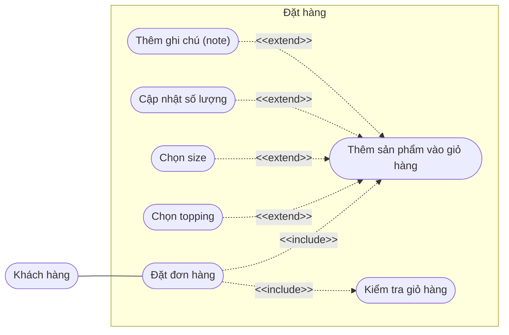
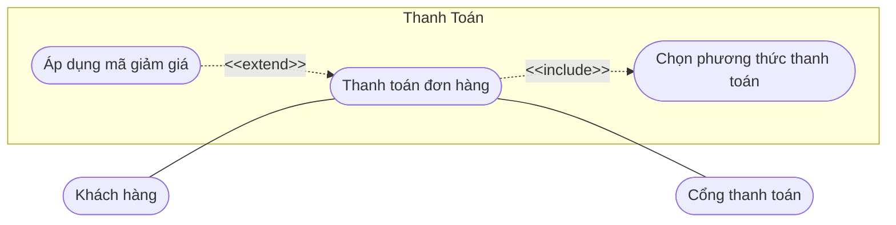

# TASK 1.3: ĐẶC TẢ MỘT USE-CASE TRỌNG TÂM (BREWLITE)

## 1. Vẽ use-case diagram

## 2. Đặc tả use-case Đặt đơn hàng (Sơ đồ đặt hàng)
|  **Thuộc tính** | **Nội dung mô tả chi tiết** |
|---|---|
| **Use-case ID** | UC-01 |
| **Use-case name** | Đặt đơn hàng |
| **Actor** | Khách hàng (Primary Actor). |
| **Requirement IDs** | FR-ORD-01, FR-ORD-02, FR-ORD-03, FR-ORD-04, FR-ORD-05, FR-ORD-06, FR-ORD-07 |
| **Description** | Khách hàng có thể sử dụng chức năng này để chọn sản phẩm từ thực đơn của cửa hàng thêm vào giỏ hàng, cùng với các lựa chọn tùy chỉnh khác (chọn size, chọn topping, cập nhật số lượng, thêm ghi chú), kiểm tra lại giỏ hàng và xác nhận đặt đơn hàng. |
| **Trigger** | Khách hàng truy cập vào màn hình thực đơn (Menu), chọn sản phẩm thêm vào giỏ hàng và nhấn nút "Đặt đơn hàng". |
| **Preconditions** | 1. Hệ thống đang hoạt động ổn định và kết nối cơ sở dữ liệu thành công. 2. Danh mục thực đơn (sản phẩm, size, topping, đơn giá, tồn kho) đã được cấu hình và đang ở trạng thái mở bán. 3. Khách hàng đã truy cập vào màn hình đặt món của hệ thống. |
| **Postconditions** | **Thành công:** Giỏ hàng được kiểm tra hợp lệ; đơn hàng mới được khởi tạo ở trạng thái `PENDING` (Chờ thanh toán), lưu đầy đủ danh sách món, size, topping, số lượng, ghi chú và tổng tiền tạm tính; hệ thống chuyển khách hàng sang màn hình Thanh toán đơn hàng.  **Thất bại:** Đơn hàng không được khởi tạo; trạng thái giỏ hàng hiện tại của khách hàng vẫn được giữ nguyên để khách hàng chỉnh sửa. |
| **Normal flow** | **1.** Hệ thống hiển thị màn hình đặt món và danh sách thực đơn (Menu) cho khách hàng.  **2.** (`<<include>>` Thêm sản phẩm vào giỏ hàng): Khách hàng lựa chọn sản phẩm từ thực đơn.  **3.** Hệ thống hiển thị chi tiết sản phẩm (size mặc định, số lượng mặc định là 1, danh sách topping đi kèm, ô nhập ghi chú).  **4.** Khách hàng nhấn xác nhận "Thêm sản phẩm vào giỏ hàng".  **5.** Hệ thống lưu sản phẩm vào giỏ hàng và cập nhật tổng số lượng món trong giỏ.  **6.** (`<<include>>` Kiểm tra giỏ hàng): Khách hàng mở giỏ hàng để kiểm tra lại danh sách sản phẩm đã chọn, các tùy chỉnh đi kèm và tổng tiền tạm tính.  **7.** Khách hàng nhấn nút "Đặt đơn hàng".  **8.** Hệ thống kiểm tra xem kho có đủ nguyên liệu để hoàn thành đơn hàng hay không.  **9.** Hệ thống ghi nhận đơn hàng hợp lệ và chuyển khách hàng sang màn hình Thanh toán đơn hàng. |
| **Exceptions** | **EX-01 (Đơn hàng chứa món không đủ nguyên liệu):** Tại bước 8, kho nguyên liệu không đủ để đáp ứng số lượng món trong đơn hàng. Hệ thống chặn tạo đơn và báo rõ tên món đang hết nguyên liệu.  **EX-02 (Giỏ hàng trống):** Khách hàng nhấn "Đặt đơn hàng" khi chưa có sản phẩm nào trong giỏ. Hệ thống vô hiệu hóa thao tác và thông báo "Giỏ hàng đang trống, vui lòng thêm sản phẩm".  **EX-03 (Số lượng không hợp lệ):** Khách hàng nhập số lượng `≤ 0` hoặc vượt quá giới hạn tối đa trên một đơn hàng. Hệ thống hiển thị thông báo lỗi và đưa về số lượng hợp lệ.  **EX-04 (Mất kết nối máy chủ):** Hệ thống báo lỗi kết nối mạng và bảo toàn nguyên vẹn dữ liệu trong giỏ hàng. |
| **Alternative flows** | **AF-01 (`<<extend>>` Chọn size - tại bước 3):** Khách hàng điều chỉnh kích cỡ sản phẩm (Size S, M, L). Hệ thống cập nhật lại đơn giá theo size rồi tiếp tục bước 4.  **AF-02 (`<<extend>>` Chọn topping - tại bước 3):** Khách hàng chọn thêm một hoặc nhiều loại topping ăn kèm. Hệ thống cộng thêm tiền topping vào giá món rồi tiếp tục bước 4.  **AF-03 (`<<extend>>` Cập nhật số lượng - tại bước 3 hoặc bước 6):** Khách hàng tăng/giảm số lượng sản phẩm. Hệ thống tính lại thành tiền của món và tổng tiền giỏ hàng (nếu giảm về 0 trong giỏ hàng thì xóa món đó khỏi giỏ).  **AF-04 (`<<extend>>` Thêm ghi chú (note) - tại bước 3):** Khách hàng nhập ghi chú riêng cho món (ví dụ: "Ít đá, 50% đường"). Hệ thống lưu ghi chú đính kèm theo món.  **AF-05 (Chọn món thay thế khi hết nguyên liệu - tại bước 8):** Hiện ra thông báo về món đã hết nguyên liệu và yêu cầu khách hàng chọn món thay thế hoặc xóa món đó khỏi giỏ hàng trước khi đặt lại. |

## 3. Đặc tả use-case Thanh toán đơn hàng (Sơ đồ thanh toán)
| **Thuộc tính** | **Nội dung mô tả chi tiết** |
|---|---|
| **Use-case ID** | UC-02 |
| **Use-case name** | Thanh toán đơn hàng |
| **Actor** | **Primary Actor (Tác nhân chính):** Khách hàng.  **Secondary Actor (Tác nhân phụ):** Cổng thanh toán. |
| **Requirement IDs** | FR-PAY-01, FR-PAY-02, FR-PAY-03, FR-PAY-04, NFR-SEC-01 |
| **Description** | Khách hàng sử dụng chức năng này để thực hiện thanh toán cho đơn hàng đã đặt thông qua việc chọn phương thức thanh toán, tùy chọn áp dụng mã giảm giá (nếu có) và giao dịch qua Cổng thanh toán để hoàn tất đơn hàng. |
| **Trigger** | Khách hàng xác nhận đặt đơn hàng thành công ở UC-01 và được chuyển sang màn hình Thanh toán đơn hàng. |
| **Preconditions** | **1.** Đơn hàng đã được khởi tạo hợp lệ từ chức năng Đặt đơn hàng (UC-01) ở trạng thái `PENDING` với tổng tiền `> 0`.  **2.** Hệ thống kết nối thông suốt với API của Cổng thanh toán. |
| **Postconditions** | **Thành công:** Đơn hàng chuyển sang trạng thái `PAID` (Đã thanh toán); lưu lịch sử giao dịch; trừ lượt dùng mã giảm giá (nếu có); trừ tồn kho nguyên liệu; làm trống giỏ hàng và gửi đơn hàng cho phía nhà bếp xem.  **Thất bại:** Đơn hàng giữ trạng thái chưa thanh toán (`UNPAID`); không mất lượt dùng mã giảm giá; không trừ kho và cho phép khách hàng thực hiện thanh toán lại. |
| **Normal flow** | **1.** Hệ thống hiển thị màn hình Thanh toán đơn hàng gồm: thông tin đơn hàng, tổng tiền tạm tính, mục nhập mã giảm giá và danh sách phương thức thanh toán.  **2.** (`<<include>>` Chọn phương thức thanh toán): Khách hàng lựa chọn một phương thức thanh toán trực tuyến hợp lệ.  **3.** Hệ thống ghi nhận phương thức thanh toán và hiển thị tổng số tiền cần thanh toán cuối cùng.  **4.** Khách hàng nhấn nút "Thanh toán đơn hàng".  **5.** Hệ thống tạo phiên giao dịch và gửi thông tin thanh toán (mã đơn, số tiền, chữ ký bảo mật) sang Cổng thanh toán.  **6.** Cổng thanh toán hiển thị giao diện thanh toán (mã QR hoặc biểu mẫu thẻ) cho Khách hàng.  **7.** Khách hàng thực hiện xác nhận thanh toán trên giao diện của Cổng thanh toán.  **8.** Cổng thanh toán xử lý trừ tiền thành công và trả kết quả phản hồi (Callback/Webhook) về cho Hệ thống.  **9.** Hệ thống cập nhật trạng thái đơn hàng thành "Đã thanh toán", thông báo thành công cho Khách hàng và chuyển đơn hàng cho phía nhà bếp xem để chế biến. |
| **Exceptions** | **EX-01 (Mã giảm giá không hợp lệ):** Mã giảm giá không tồn tại, đã hết hạn, hết lượt sử dụng hoặc đơn hàng chưa đủ giá trị tối thiểu. Hệ thống báo lỗi "Mã giảm giá không hợp lệ hoặc không đủ điều kiện" và giữ nguyên tổng tiền ban đầu.  **EX-02 (Giao dịch thất bại tại Cổng thanh toán):** Khách hàng không đủ số dư, nhập sai OTP hoặc thẻ bị khóa. Cổng thanh toán trả mã lỗi thất bại về hệ thống.  **EX-03 (Chưa chọn phương thức thanh toán):** Khách hàng nhấn "Thanh toán đơn hàng" khi chưa chọn phương thức thanh toán. Hệ thống chặn thao tác và yêu cầu chọn phương thức.  **EX-04 (Hết thời gian chờ thanh toán - Timeout):** Phiên giao dịch trên Cổng thanh toán quá hạn (15 phút). Hệ thống hủy phiên giao dịch và thông báo hết hạn thanh toán. |
| **Alternative flows** | **AF-01 (`<<extend>>` Áp dụng mã giảm giá - trước bước 4):** Khách hàng nhập/chọn mã giảm giá. Hệ thống kiểm tra mã hợp lệ, khấu trừ số tiền giảm giá, cập nhật lại tổng tiền thanh toán mới rồi tiếp tục bước 3.  **AF-02 (Thanh toán thất bại và thử lại - tại bước 8):** Khi nhận thông báo lỗi từ EX-02, hệ thống hiển thị thông báo "Thanh toán không thành công" kèm lý do và cho phép khách hàng chọn lại phương thức thanh toán khác để thử lại từ bước 2.  **AF-03 (Khách hàng chủ động hủy trên Cổng thanh toán - tại bước 6):** Khách hàng nhấn "Hủy / Quay lại" trên màn hình Cổng thanh toán. Hệ thống đóng phiên giao dịch hiện tại và điều hướng khách hàng quay lại màn hình chọn phương thức thanh toán (bước 2). |

## 3. Liên kết use-case với mã yêu cầu (REQUIREMENT TRACEABILITY MATRIX)
Bảng dưới đây liên kết trực tiếp từng Use-case con trong 2 sơ đồ với các Mã yêu cầu chức năng (Functional Requirements - FR) và phi chức năng (Non-Functional Requirements - NFR).

| **Mã yêu cầu** | **Tên yêu cầu** | **Mô tả chi tiết yêu cầu** | **Use-case liên kết** | **Sơ đồ** |
|---|---|---|---|---|
| FR-ORD-01 | Khởi tạo đơn hàng | Hệ thống cho phép khách hàng gửi yêu cầu tạo đơn hàng mới từ các sản phẩm trong giỏ và kiểm tra tồn kho nguyên liệu. | Đặt đơn hàng | Đặt hàng |
| FR-ORD-02 | Thêm sản phẩm vào giỏ | Hệ thống bắt buộc có bước thêm sản phẩm từ thực đơn vào giỏ hàng trước khi đặt đơn. | Thêm sản phẩm vào giỏ hàng (`<<include>>`) | Đặt hàng |
| FR-ORD-03 | Kiểm tra giỏ hàng | Hệ thống bắt buộc cho phép khách hàng xem và kiểm tra danh sách món, đơn giá, tổng tiền trong giỏ trước khi chốt đơn. | Kiểm tra giỏ hàng (`<<include>>`) | Đặt hàng |
| FR-ORD-04 | Tùy chọn Topping | Hệ thống cho phép khách hàng chọn thêm các loại topping đi kèm sản phẩm và cộng tiền tương ứng. | Chọn topping (`<<extend>>`) | Đặt hàng |
| FR-ORD-05 | Tùy chọn kích cỡ (Size) | Hệ thống cho phép khách hàng thay đổi size sản phẩm và cập nhật giá theo size. | Chọn size (`<<extend>>`) | Đặt hàng |
| FR-ORD-06 | Cập nhật số lượng món | Hệ thống cho phép khách hàng tăng/giảm số lượng sản phẩm khi thêm vào giỏ hoặc trong giỏ hàng. | Cập nhật số lượng (`<<extend>>`) | Đặt hàng |
| FR-ORD-07 | Ghi chú món ăn/đồ uống | Hệ thống cho phép khách hàng đính kèm ghi chú (note) yêu cầu chế biến riêng cho từng món. | Thêm ghi chú (note) (`<<extend>>`) | Đặt hàng |
| FR-PAY-01 | Xử lý thanh toán đơn hàng | Hệ thống thực hiện quy trình thanh toán cho đơn hàng và cập nhật trạng thái đơn sau khi giao dịch. | Thanh toán đơn hàng | Thanh toán |
| FR-PAY-02 | Chọn phương thức thanh toán | Hệ thống bắt buộc khách hàng chọn một phương thức thanh toán hợp lệ cho đơn hàng. | Chọn phương thức thanh toán (`<<include>>`) | Thanh toán |
| FR-PAY-03 | Áp dụng mã khuyến mãi | Hệ thống cho phép khách hàng nhập/chọn mã giảm giá, kiểm tra tính hợp lệ và khấu trừ vào tổng tiền đơn hàng. | Áp dụng mã giảm giá (`<<extend>>`) | Thanh toán |
| FR-PAY-04 | Tích hợp Cổng thanh toán | Hệ thống kết nối hai chiều với Actor Cổng thanh toán để gửi yêu cầu thu tiền và nhận kết quả giao dịch. | Thanh toán đơn hàng | Thanh toán |
| NFR-SEC-01 | Bảo mật & Toàn vẹn giao dịch | Đảm bảo không trùng lặp giao dịch (Idempotency), dữ liệu truyền qua Cổng thanh toán phải được mã hóa chữ ký số. | Thanh toán đơn hàng | Thanh toán |

